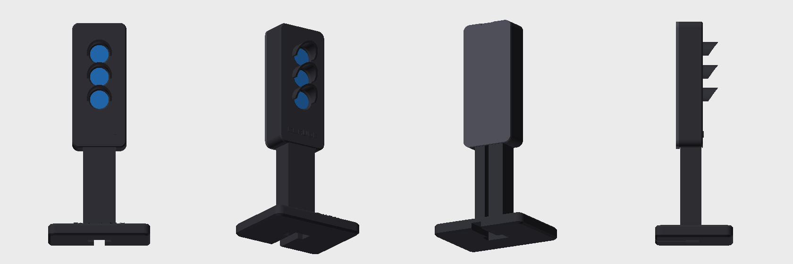

# Semáforo de Claude Code · Firmware LilyGo T-Display-S3

Hecho por **Mr Dave**.



Convierte una LilyGo T-Display-S3 en un semáforo que muestra el estado de Claude Code. La pantalla dibuja tres luces (rojo, amarillo, verde) y cambia según las líneas que recibe por USB-serie.

## Estados
| Comando | Luz | Significado |
|---|---|---|
| `THINKING` | Amarillo respirando | Claude está pensando o usando herramientas |
| `WAITING` | Rojo fijo (5 min → IDLE) | Te espera: permiso o pregunta |
| `ERROR` | Rojo parpadeando | Falló una herramienta |
| `DONE` | Verde fijo (60 s → IDLE) | Terminó |
| `IDLE` | Verde suave respirando | Libre |

## Ajustes (se guardan en la flash)
| Comando | Qué hace |
|---|---|
| `ROT` | Gira la imagen 180° |
| `CAL <px>` | Mueve las luces para centrarlas en las ventanas de la carcasa (ej. `CAL 10`, `CAL -10`) |
| `MODE L` | Carcasa con 3 ventanas redondas |
| `MODE V` | Carcasa con ventana rectangular (luces + texto del estado) |

Velocidad serie: 115200.

## Piezas para imprimir (`stl/`)
La placa queda encerrada; solo se ve la pantalla, que dibuja las tres luces detrás de tres ventanas con visera.

| Archivo | Cómo imprimir |
|---|---|
| `semaforo_cuerpo_luces.stl` | Tal cual: cara trasera abierta sobre la cama, viseras hacia arriba. Sin soportes. Usar `MODE L`. |
| `semaforo_cuerpo_ventana.stl` | Alternativa con ventana rectangular (luces + texto del estado). Usar `MODE V`. |
| `semaforo_tapa.stl` | Plana, topes hacia arriba. Entra a presión. |
| `semaforo_poste_base.stl` | Base sobre la cama. Sin soportes. |

PLA o PETG, capa 0.16–0.2 mm, 3 perímetros, 15 % de relleno. Imprime **un** cuerpo (luces o ventana), la tapa y el poste.

### Montaje
1. Pasa el cable USB-C por la ranura trasera del poste y la base (el enchufe queda dentro del poste, arriba).
2. Conecta el enchufe a la placa y mete la placa con la pantalla hacia el frente y el USB abajo.
3. Encaja el poste en el hueco inferior del cuerpo y cierra con la tapa.
4. El agujerito lateral derecho da acceso al botón con un clip.
5. Si las luces no quedan centradas en las ventanas, usa `CAL <px>`; si salen al revés, `ROT`.

## Compilar y cargar
Requiere [PlatformIO](https://platformio.org/).
```bash
pio run -t upload
pio device monitor   # para probar comandos a mano
```
La primera vez puede que la placa solo aparezca después de mantener **BOOT** y pulsar **RST**.

## Hardware
- LilyGo T-Display-S3 (ESP32-S3, ST7789 170×320, bus paralelo de 8 bits)
- Librería: LovyanGFX

## Conectarlo a Claude Code
Se envía una línea por evento usando los hooks de Claude Code (`UserPromptSubmit`, `PreToolUse`, `PostToolUse`, `PermissionRequest`, `PostToolUseFailure`, `Stop`…). Basta con escribir el estado en el puerto serie de la placa, por ejemplo:
```bash
echo WAITING > /dev/cu.usbmodem1101
```

---
© Mr Dave
